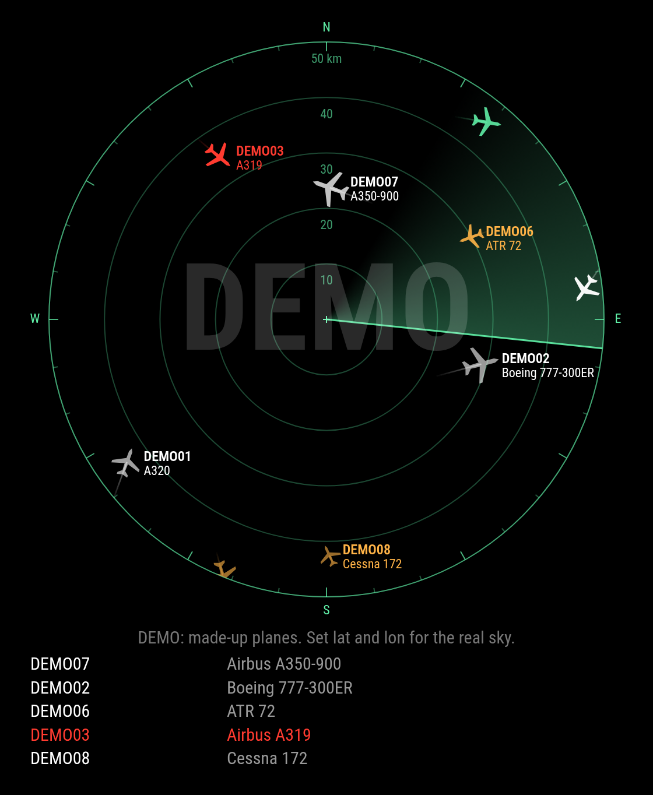

# MMM-SkyScope

A live radar scope of the planes around your home for [MagicMirror²](https://magicmirror.builders/). Each plane is a silhouette turned the way it flies, coloured by its height, with a trail behind it and a sweeping beam over the top. The nearest flights are listed underneath.



Inspired by [OWLOS Flight Radar](https://github.com/KirinDenis/OWLOS-FLIGHT-RADAR) for ESP32 boards. This is a separate project with its own code.

## Install

Clone it into your MagicMirror modules folder. It has no dependencies, so there is nothing to `npm install`.

```sh
cd ~/MagicMirror/modules
git clone https://github.com/roman-mueller-ch/MMM-SkyScope
```

Add it to `config/config.js`, with your own `lat` and `lon`:

```js
{
	module: "MMM-SkyScope",
	position: "top_left",
	config: {
		lat: 47.37,
		lon: 8.54,
		rangeKm: 50
	}
}
```

Without `lat` and `lon` it flies a made-up sky, marked DEMO in big letters.

## Options

| Option | Default | What it does |
| --- | --- | --- |
| `lat`, `lon` | `null` | Your home. Without them the module runs the demo. |
| `rangeKm` | `50` | Radius of the scope in km, up to 450. |
| `units` | `"km"` | Distances shown in `"km"`, `"nm"` or `"mi"`. |
| `rotation` | `0` | The compass bearing at the top of the scope. |
| `size` | `420` | Width and height of the scope in pixels. |
| `color` | `"#66ffb2"` | Colour of the scope. Any CSS colour without transparency. |
| `updateInterval` | `15000` | Milliseconds between requests, at least 10000. |
| `sweepSeconds` | `6` | Seconds for one turn of the beam. |
| `frameRate` | `12` | Frames per second for the beam. The planes redraw at most twice a second. Lower it on a slow Raspberry Pi. |
| `hideGround` | `true` | Hide planes parked or taxiing. |
| `trailLength` | `12` | Reports kept in each trail. |
| `labelCount` | `6` | Most planes labelled on the scope. |
| `listCount` | `5` | Rows in the list, `0` for none. |
| `followPresence` | `true` | Stop drawing and fetching while [MMM-PIR-Sensor](https://github.com/paviro/MMM-PIR-Sensor) has the screen off. Has no effect without that module, with its `powerSaving` off or with an `alwaysOnPin` set. |
| `demo` | `false` | Show the made-up sky even with a home set. |

## Reading the scope

- **Grey:** on the ground
- **Amber:** under 10,000 ft
- **The scope's colour:** 10,000 to 25,000 ft
- **White:** above 25,000 ft
- **Blinking red and white:** emergency (squawk 7500, 7600 or 7700, or an emergency status)

Labels show the flight level, with an arrow when the plane is climbing or descending. `FL350↓` is about 35,000 ft and coming down.

## Data and privacy

Planes come from the free community networks [adsb.lol](https://adsb.lol/), with [adsb.fi](https://adsb.fi/) as the fallback. The status line says which one answered. Check their terms if you use this for anything beyond a personal mirror.

Your home is rounded to about a kilometre before it is sent, so the feeds learn the area and not the address. The exact position stays on the mirror and is used only to draw the scope.

Coverage depends on who feeds these networks near you, so some aircraft may be missing. This is a toy built on public data and nothing to navigate by.

## Tests

```sh
npm test
```
